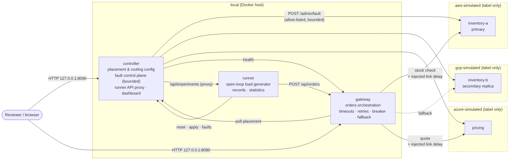
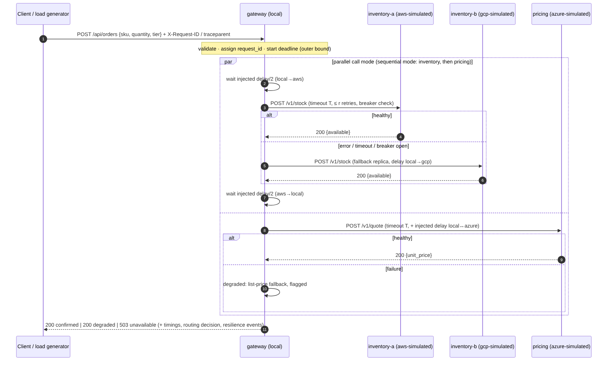
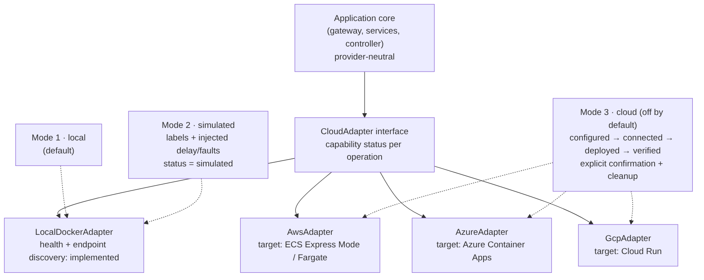
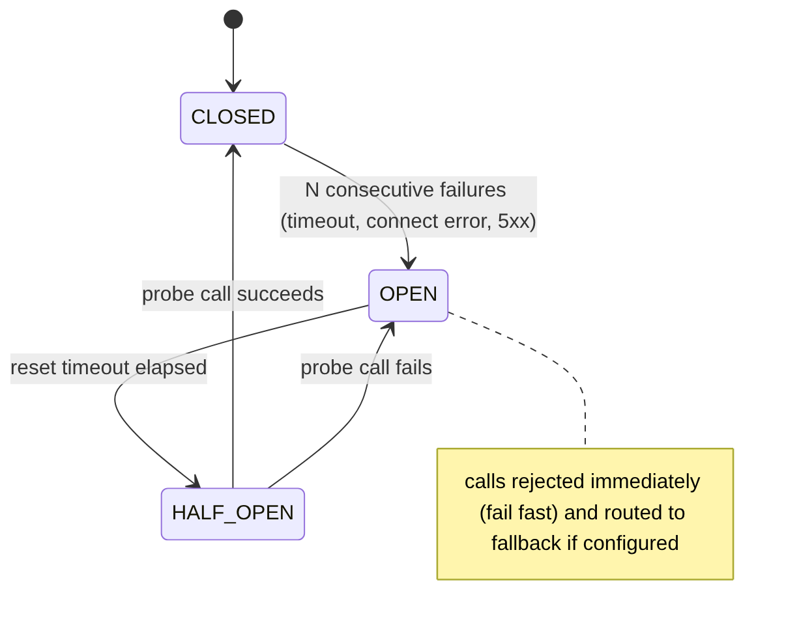

# SETU-X Architecture

SETU-X · Parv Agarwal, Junior Research Associate (Technical), AI NLP ML Research Laboratory, IIT Patna
Status: **Phases 2–4 implemented** (services, placement, routing, controller, adapter boundary, delay and fault injection, resilience policies). Sections for Phases 5–6 are still design. Each section names the phase that implements it and the test that verifies it. Citation keys refer to `docs/references.bib`.

---

## 1. Design goals

1. Runs on one ordinary computer with `docker compose up --build -d`. No cloud account, paid cluster, monitoring service or cloud database.
2. The smallest service set that can test H1–H5 (`docs/research_questions.md`).
3. Everything simulated is labelled as simulated: in the UI, the API responses and every exported file.
4. No privileged containers and no Docker-socket mounts in the normal demo.
5. Provider-specific code is isolated behind one adapter interface. Real-cloud operations are off by default.

## 2. Components



*Figure 1. Containers and their (simulated) environment labels. Dashed boxes are labels attached to containers on the same Docker host, not separate infrastructure. Source: `figures/architecture.mmd`.*

| Container | Responsibility | Default env label | Published port | Phase |
|---|---|---|---|---|
| `gateway` | Public API; input validation; request ID and `traceparent`-compatible trace ID; orchestrates the order flow (call mode `parallel` or `sequential`); applies injected link delay (simulated mode); timeouts, bounded retries with jitter, circuit breaker, fallback; records routing decisions and resilience events; end-to-end timing | `local` | `127.0.0.1:8080` | 2–4 |
| `inventory-a` | Deterministic stock check; bounded fault injection (error / slow / hang) | `aws-simulated` | none (internal) | 2, 4 |
| `inventory-b` | Second inventory replica for fallback and failure-domain experiments | `gcp-simulated` | none | 3–4 |
| `pricing` | Deterministic price quote; can be made slow or failing; the gateway then returns a *degraded* order using a flagged list price | `azure-simulated` | none | 2, 4 |
| `controller` | Source of truth for placement, routing and link-delay config; bounded fault control plane; health aggregation; **experiment runner** (load generator); results storage and CSV/JSON export; serves the dashboard; hosts the adapter registry | `local` | `127.0.0.1:8090` | 3, 5, 6 |

**Why the order logic lives in the gateway.** A separate `orders` hop would add a dependency without testing anything that H1–H5 need. If a deeper call graph is needed later (for example a three-level chain for H4), it can be split out without changing the experiment harness.

**Why the experiment runner lives in the controller.** The dashboard must start bounded experiments, and the runner needs the controller's config and fault APIs. The cost: the load generator shares the host CPU with the system under test. This is recorded as a threat to validity and mitigated with bounded rates and per-run CPU readings where available. A CLI entry point (`python -m setu_x.experiments.runner`) runs the same code from the host or a separate container.

**Packaging.** One Python package (`setu_x`) and one image. Each container runs a different module (`setu_x.services.gateway`, …). That keeps builds fast and dependencies identical across services. Each service is still a separate process and container with its own health endpoints.

## 3. Request flow



*Figure 2. `POST /api/orders` in parallel call mode. In sequential mode, inventory completes before pricing starts. Source: `figures/request_flow.mmd`.*

**Outcomes**

| Outcome | HTTP | Condition |
|---|---|---|
| `confirmed` | 200 | inventory answered (primary or fallback) and pricing answered |
| `degraded` | 200 | inventory answered; pricing failed, so a list price is used and `price_source = "fallback-list-price"` |
| `rejected` | 409 | inventory answered but stock is insufficient (deterministic business outcome, not a failure) |
| `unavailable` | 503 | inventory failed on all eligible replicas, or the gateway's outer deadline expired |
| `invalid` | 422 | request failed validation |

**Termination bound.** Every gateway request ends within an outer deadline (default 3,000 ms, configurable, validated ≤ 10,000 ms). Per-call timeouts, retries and backoff are clipped to the remaining deadline, so no request can hang. *Verified in Phase 2/4 by a test with a hanging dependency.*

## 4. Configuration model

All configuration is YAML under `configs/`, validated at startup by Pydantic models. Invalid values (unknown environment, negative delay, retries above the cap, a placement that references a missing instance) fail with a message naming the field. *Phase 3 test: one test per validation rule.*

```yaml
# configs/environments.yaml (illustrative values, NOT measured provider latencies)
# (the execution mode is a deployment setting: SETU_MODE=local|simulated|cloud, not part of this file)
environments:
  local:          {provider: local}
  aws-simulated:  {provider: aws,   simulated: true}
  azure-simulated: {provider: azure, simulated: true}
  gcp-simulated:  {provider: gcp,   simulated: true}
link_rtt_ms:               # symmetric round-trip delay injected per call between two environments
  local--aws-simulated: 40
  local--azure-simulated: 55
  local--gcp-simulated: 45
  aws-simulated--azure-simulated: 70
  aws-simulated--gcp-simulated: 60
  azure-simulated--gcp-simulated: 65
  # same environment: 0
```

The default RTTs are placeholders of a plausible order of magnitude for client-to-cloud paths [corneo2021clouds]. They are **not** calibrated to any real inter-provider path. Experiments set link delays explicitly in their scenario files, and the baseline uses 0.

```yaml
# configs/placement.yaml
call_mode: parallel          # parallel | sequential
services:
  inventory:
    routing: primary-fallback   # primary-fallback | round-robin | weighted
    instances:
      - {name: inventory-a, env: aws-simulated, url: "http://inventory-a:8000", role: primary}
      - {name: inventory-b, env: gcp-simulated, url: "http://inventory-b:8000", role: secondary}
  pricing:
    instances:
      - {name: pricing, env: azure-simulated, url: "http://pricing:8000", role: primary}
resilience:
  outer_deadline_ms: 3000
  timeout_ms: 800            # per attempt
  retries: 0                 # 0..3 (capped)
  backoff: {base_ms: 50, max_ms: 400, jitter: full}
  circuit_breaker: {enabled: false, consecutive_failures: 5, reset_timeout_ms: 5000}
  fallback: true
```

The gateway fetches placement from the controller every 2 s (`SETU_POLL_INTERVAL_MS`). It starts from `configs/placement.yaml`, re-validates everything it receives, and keeps the last valid placement if the controller is unreachable or sends something invalid. `GET /health/ready` → `info` reports `placement_source` (`file`/`controller`), `placement_version`, `controller_reachable` and `last_error`, so control-plane loss is observable but not fatal (tested in `test_gateway_routing.py` and acceptance check B13).

Runtime placement changes (`PUT /api/placement`) are held in the controller's memory. Restarting the controller reverts to `placement.yaml`, and the gateway follows. The API cannot add instances or URLs: names and URLs must match the file (this prevents the control API being used to point the gateway at arbitrary hosts).

**Environment labels in each mode.** In `local` mode, labels are still reported (and marked `simulated: true`), but no link delay is injected. In `simulated` mode, the configured link delays are injected (Phase 4). Every order response lists `simulated_environments` and carries a `simulation_notice` whenever a simulated label was involved.

## 5. Delay and fault injection (implemented in Phase 4)

| Mechanism | Where | What it models | Bounds | Labelled as |
|---|---|---|---|---|
| Link delay | Gateway HTTP client (`gateway/client.py`): when `SETU_MODE=simulated`, sleeps RTT/2 before sending and RTT/2 after receiving, for the (gateway env, instance env) pair. Both halves count against the per-attempt timeout | Network RTT between environments | 0–2,000 ms per link; matrix changeable at runtime via `PUT /api/links` (validated, complete matrix) | `injected_delay_ms` per dependency; `resilience.injected_delay_ms_critical_path` (max for parallel calls, sum for sequential) |
| Service fault `error` | Route dependency on `/v1/*` in inventory/pricing (`faults.py`) | Failing dependency | status 500/502/503/504; probability *p* ∈ [0,1] with optional seed; duration 1–300 s | `injected_fault` error envelope; fault events |
| Service fault `slow` | same | Overloaded dependency | `delay_ms` 1–5,000; duration 1–300 s | fault events |
| Service fault `hang` | same; holds until the fault expires or 30 s pass, then 503 | Unresponsive dependency (exercises timeouts) | duration 1–300 s, hang ≤ 30 s per request | fault events |
| Container stop | `scripts/fault_container.ps1 -Service inventory-a -Seconds 20` on the host (`docker compose stop/start`), prints UTC stop/start/healthy times | Process or instance failure | 1–300 s; allow-listed services | JSON line from the script |

Faults are implemented as a FastAPI route dependency, not middleware, so injected responses still carry `X-Request-ID`/`traceparent` and appear in access logs. Health endpoints are not affected (application-level fault). To model a dead process, stop the container.

**Control API (controller, 127.0.0.1:8090):** `POST /api/faults {target, mode, duration_s, probability?, delay_ms?, error_status?, seed?}`, `GET /api/faults`, `DELETE /api/faults/{target}`, `DELETE /api/faults`. Every call is validated against the same `FaultSpec` model, and recorded in `GET /api/events`.

**Safety.**
- Fault targets are an allow-list built from `placement.yaml` (`inventory-a`, `inventory-b`, `pricing`); the gateway and controller cannot be targeted.
- Every fault has a mandatory duration (≤ 300 s) and auto-expires.
- A new fault replaces the previous one on that instance.
- `/admin/fault` on the services exists only on the internal Compose network (no published ports). The controller on `127.0.0.1:8090` is the only control surface, and it is local-development only (no authentication).

**Why not `tc netem` or Toxiproxy.** `netem` needs `NET_ADMIN`, which the brief excludes, and even kernel emulation deviates from its settings [jurgelionis2011netem; becker2022emulation]. Toxiproxy [toxiproxy] would add a proxy hop per link and a second control plane. The in-process wrapper keeps the injected amount exact and exportable. Its limitation is that it models no jitter, loss or bandwidth constraints. *Validated:* in simulated mode, a parallel order measured ≥ 55 ms total with 40/55 ms injected, and a runtime change to 150 ms gave ≥ 150 ms (Phase 4 acceptance C13; `test_resilience_flow.py`).

## 6. Execution modes and the provider adapter boundary



*Figure 3. The application core only talks to the `CloudAdapter` interface. Source: `figures/modes.mmd`.*

### 6.1 Adapter contract (Phase 3)

```python
class CloudAdapter(Protocol):
    provider: str                                  # "local" | "aws" | "azure" | "gcp"
    def capabilities(self) -> dict[Operation, OperationSupport]: ...
    def status(self) -> AdapterStatus: ...         # simulated | configured | connected | deployed | verified
    def discover_environments(self) -> list[DeploymentEnvironment]: ...
    def deploy_service(self, spec: ServiceSpec, *, confirm: bool) -> DeploymentResult: ...
    def service_status(self, name: str) -> ServiceStatus: ...
    def health_check(self, endpoint: ServiceEndpoint) -> HealthStatus: ...
    def discover_endpoints(self) -> list[ServiceEndpoint]: ...
    def fetch_logs(self, name: str, since: datetime) -> LogResult: ...
    def fetch_metrics(self, name: str) -> list[ResourceObservation]: ...
    def cleanup(self, resource_ids: list[str], *, confirm: bool) -> CleanupResult: ...
    def estimate_cost(self, spec: ServiceSpec) -> CostEstimate: ...   # may return "unavailable"
```

`Operation` covers each method. `OperationSupport` is one of `implemented`, `not_implemented`, `unsupported_by_provider`. Calling an operation that is not `implemented` raises a typed error. It never returns fabricated data. The contract test suite (`tests/contract/`) runs the same tests against all four adapters without credentials.

Implemented in Phase 3: `adapters/base.py` (contract and guards), `adapters/local_docker.py` (status `local`: environment/endpoint discovery, health checks, service status), and `adapters/cloud.py` (AWS/Azure/GCP skeletons: configuration validation only, every operation `not_implemented`). Details and the plan for real integration are in `docs/cloud_setup.md`.

### 6.2 Status ladder (never used interchangeably)

| Status | Meaning | How it is reached |
|---|---|---|
| `local` | The local Docker host itself (the `local-docker` adapter) | always |
| `simulated` | Logical environment label on the local Docker host | default for `*-simulated` |
| `not_configured` | Real-provider adapter without (complete) configuration | default for aws/azure/gcp |
| `configured` | Required configuration supplied and validated (region, names, credentials source present) | config validation passes |
| `connected` | An authenticated provider API call succeeded | e.g. AWS STS `GetCallerIdentity` |
| `deployed` | A real resource was created or updated, and its ID was recorded | deploy call returns a resource ID |
| `verified` | Deployment smoke test **and** application smoke test (health + one order) passed against the real endpoint | smoke test script |

`connected` does not imply `deployed`, and `deployed` does not imply a healthy application.

### 6.3 Real-cloud target mapping (Phase 3 skeletons; optional later work)

| Compose service | AWS | Azure | GCP |
|---|---|---|---|
| any service image | ECS Express Mode service (Fargate task, ALB, auto scaling, URL) [awsecsexpress; awsfargate] | Azure Container App [azurecontainerapps] | Cloud Run service [gcpcloudrun] |
| `gateway` (public) | public HTTPS endpoint via ALB | external ingress | public `*.run.app` URL |
| `inventory-*`, `pricing` (internal) | private service (or public HTTPS with auth for cross-cloud) | internal ingress, DNS service discovery | ingress restricted or authenticated invocations |
| cost notes | ALB, Fargate, CloudWatch and data transfer are billed; Express Mode itself adds no charge [awsecsexpress] | scale-to-zero possible; idle replicas may bill at a lower rate [azurecontainerapps] | request-based or instance-based billing; free tier exists [gcpcloudrun] |

AWS App Runner was considered and **rejected**: it is no longer open to new customers, and AWS recommends ECS Express Mode [awsapprunnerchange].

**Caveats**
- Identical images do not guarantee identical behaviour. Cold starts, scale-to-zero, CPU allocation, egress paths and TLS termination differ by platform.
- A *cross-provider* hybrid deployment needs public HTTPS between providers, plus service-to-service authentication. That is outside the first release.

### 6.4 Cost and safety rules for Mode 3

Mode 3 is off unless `SETU_MODE=cloud` **and** `SETU_ALLOW_CLOUD_OPERATIONS=yes`. Every create call:

1. Prints provider, region, resources and the cost-estimate status (or "estimate unavailable; review the provider pricing calculator").
2. Requires an interactive confirmation.
3. Records resource IDs to `results/cloud_resources.json`.
4. Has a matching tested cleanup that reports anything it could not delete.

Credentials come only from the provider's standard credential chain, never from the repository.

## 7. Resilience policy semantics (implemented in Phase 4)



*Figure 4. Circuit breaker, one instance per downstream instance, kept in the gateway. Source: `figures/breaker.mmd`.*

Code: `setu_x/resilience.py` (backoff, breaker, event log) and `setu_x/services/gateway/resilient.py` (the call loop). All settings come from `placement.yaml` → `resilience` and can be changed at runtime through `PUT /api/placement`.

- **Failure** means: timeout, connection error, transport error, HTTP 5xx, or a malformed response. A 4xx is not a dependency failure: it means the gateway built a bad request. It is neither retried nor sent to another instance.
- **Timeout:** per attempt, `min(timeout_ms, remaining outer deadline)`, enforced by both httpx and an asyncio timeout. Injected link delay counts against it.
- **Retries:** at most `retries` (capped at 3), only for retryable failures (timeout, connection, transport, 5xx). Backoff before retry *k* (k = 1..retries) is `uniform(0, min(max_ms, base_ms·2^(k-1)))` ("full jitter"). The random generator can be seeded with `SETU_RANDOM_SEED`. A retry is skipped (event `retry_skipped`) if the remaining outer deadline is shorter than the backoff. Calls per service per order ≤ (1 + retries) × candidates. *Verified:* a scripted always-failing dependency received exactly 3 calls with retries = 2 (`test_retry_amplification_is_bounded`), and with a real p = 0.5 fault, inventory-a received exactly as many requests as the gateway reported attempts (acceptance C9).
- **Breaker:** each attempt is recorded. After `consecutive_failures` failures in a row it goes CLOSED → OPEN. After `reset_timeout_ms` the next call is the single HALF_OPEN probe; other calls are rejected while the probe is in flight. The probe's success or failure decides CLOSED or OPEN. A granted probe that never produced an outcome (deadline passed, request cancelled) is released by its owner only. Breakers reset when the placement or link matrix changes. Every transition is an event with a UTC timestamp (`GET /api/resilience/events?type=breaker_transition`); states are at `GET /api/resilience/breakers`.
- **Fallback:** if `resilience.fallback` is true, the gateway tries the routing decision's candidates in order (for `primary-fallback`: primary, then secondaries) when an instance fails or its breaker is open. The response shows the routed instance, the instance that actually served (`served_instance`), `fallback_used`, and a per-instance `tried` list (outcome and attempts). Pricing has a single instance, so its failure still leads to a `degraded` order.
- **Degraded pricing:** a deterministic list price is used and flagged. The analysis counts it as `degraded`, never as `confirmed`.

None of these mechanisms guarantees availability. They change *which* failures the client sees and how fast. **Recovery time depends on traffic:** a breaker only leaves OPEN when a request arrives after the reset timeout, so recovery measured with sparse traffic (as in the Phase 4 acceptance) differs from recovery under continuous load (Phase 5).

## 8. Measurement model (Phase 5)

### 8.1 Records

Each experiment writes `results/<experiment_id>/`:

- `manifest.json`: experiment ID (UTC timestamp + random suffix, checked unique); Git commit or `version`; UTC start and end; scenario file content; random seed; workload parameters; environment, placement and resilience config snapshot; `environment_mode`; image digest and Python/package versions; host CPU count; warnings.
- `observations.jsonl` and `observations.csv`: one row per request with: `experiment_id, run_index, seq, phase (warmup|measure), request_id, t_send_utc, latency_ms, http_status, outcome, gateway_total_ms, inventory_ms, pricing_ms, inventory_instance, inventory_env, pricing_env, retries, breaker_state_inventory, injected_delay_ms, error_type`.
- `events.jsonl`: fault start/end, breaker transitions, config changes.
- `summary.json`: per-run and pooled statistics, plus `validation` (row counts reconcile with summary counts; rejected or flagged rows listed).

### 8.2 Metric definitions

| Metric | Unit | Definition / aggregation | Limitations |
|---|---|---|---|
| total / successful / failed requests | count | rows in the measurement phase; success = outcome ∈ {confirmed, rejected}; `degraded` reported separately | warm-up rows excluded and reported |
| HTTP status distribution | count per code | histogram of `http_status`; client-side errors (no response) under `error_type` | — |
| throughput | req/s | successful requests ÷ measurement-window seconds | bounded by the offered load in an open-loop test |
| latency mean, median, p90, p95, p99 | ms | computed from raw `latency_ms` of measurement-phase rows; percentile = linear interpolation (NumPy default); p99 reported only if n ≥ 1,000 in that run, p95 only if n ≥ 200, otherwise "insufficient samples" | client-observed; includes injected delay |
| per-dependency latency | ms | `inventory_ms`, `pricing_ms` as measured by the gateway around each call (including retries) | — |
| timeout / retry counts | count | from gateway resilience events | — |
| breaker transitions | count, timestamps | from `events.jsonl` | — |
| recovery time | s | time from fault end until the 1-second rolling success rate first returns to ≥ 95% of the baseline success rate and stays there for 3 s | depends on window choice; reported with the parameters |
| CPU / memory | % / MiB | `docker stats` samples during the run when available; otherwise "not measured" | sampling interval ~1 s; host-level contention |

**Across runs:** percentiles are never averaged [promhistograms; papadopoulos2021methodological]. Between-condition comparisons use run-level statistics (median of per-run medians, with a bootstrap 95% CI over runs). Pooled percentiles come from pooled raw rows, labelled as pooled.

### 8.3 Load generation

The generator is open-loop at a fixed target rate (seeded constant or Poisson arrivals), with a cap on in-flight requests. Requests that cannot be sent because the cap is reached are counted as `generator_dropped`, not silently skipped. Defaults: 5 s warm-up, then 30 s measurement, 3 runs per condition. These are adjustable and bounded (≤ 300 s, ≤ 100 req/s) in dashboard-started experiments.

## 9. Observability

- **Structured logs:** JSON lines with `ts, level, service, env, request_id, trace_id, event`.
- **Correlation:** the gateway accepts or creates `X-Request-ID` and a W3C `traceparent` header and forwards both downstream [w3ctracecontext; otelcontext; sigelman2010dapper]. A full OpenTelemetry SDK and exporter are an optional extension, not a first-release dependency.
- **`/metrics`:** Prometheus text format, exposing request counters and latency *histograms* per service. An optional Compose profile `monitoring` adds Prometheus. The dashboard does not depend on it.

## 10. Container hardening (Phase 2)

- Base image `python:3.11-slim`.
- Non-root user; read-only root filesystem with `tmpfs` for `/tmp`.
- `cap_drop: [ALL]`; `security_opt: [no-new-privileges:true]`.
- CPU and memory limits per service. In Kubernetes terms, CPU limits are enforced by throttling and memory limits by out-of-memory kills [k8sresources]. A Phase 2 test reads the applied Compose limits back from `docker inspect` rather than assuming them.
- Published ports bound to `127.0.0.1`.
- Health checks drive `depends_on: condition: service_healthy` [composespec].
- Liveness (`/health/live`: the process is up) is kept separate from readiness (`/health/ready`: config loaded and the service can serve), mirroring Kubernetes semantics: a failing liveness probe leads to a restart, a failing readiness probe stops traffic routing [k8sprobes].
- Compatible with Docker Compose v5.1.3 (Parv's Windows install) and later.

## 11. Experiment feasibility check

| Exp. | Needs | Provided by |
|---|---|---|
| A | load generator, raw records | controller runner, §8 |
| B | per-link injected delay; call mode switch | gateway client wrapper, `call_mode` |
| C | fault on primary inventory; container stop | service fault middleware; `fault_container.sh` |
| D | toggle timeout / retries / breaker | `resilience` config |
| E | stepped offered load; CPU/mem | runner rate steps; `docker stats` sampler |
| F | change placement of pricing/inventory | `placement.yaml` env labels + link matrix |
| G | secondary replica in another env; fallback toggle | `inventory-b`, `fallback: true/false` |
| H | user-supplied illustrative unit prices | cost model module, labelled "modeled" |

All eight experiments run on the five containers above. None requires credentials.

## 12. Known architectural limitations

- All simulated "environments" share one kernel, CPU, memory and network. Failure independence and real WAN behaviour are not represented (see `docs/limitations.md`, Phase 8).
- The load generator shares the host with the system under test.
- Injected delay is constant per link: no jitter distribution, loss or bandwidth model.
- One gateway instance, so the gateway itself is a single point of failure by design. This keeps the experiments interpretable.
