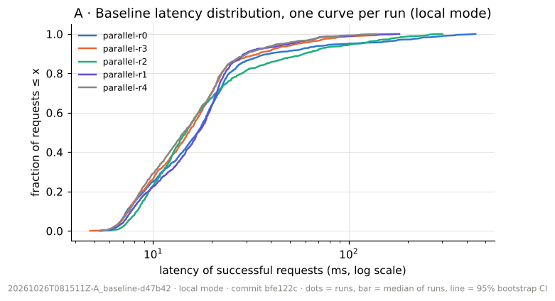
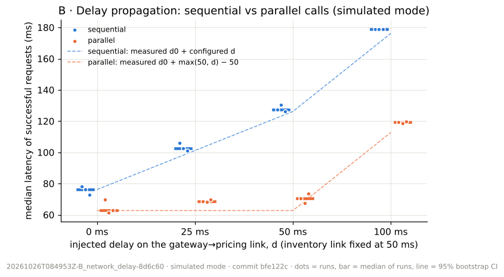
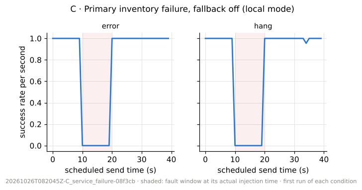
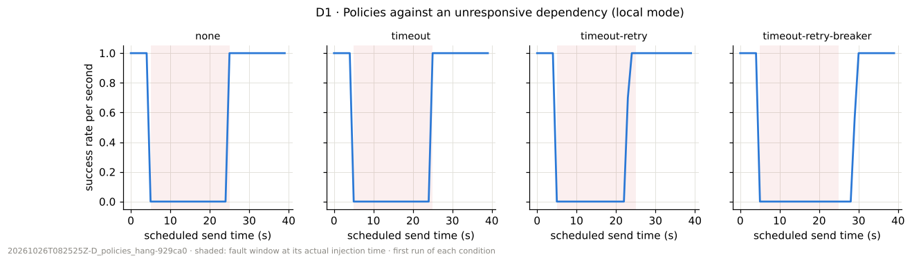
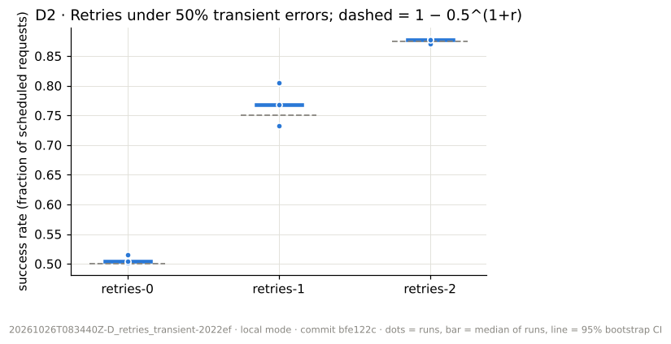
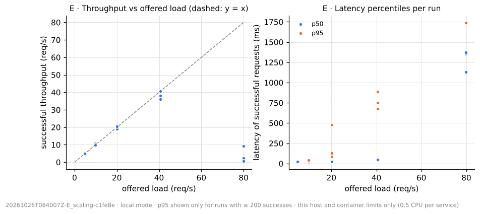
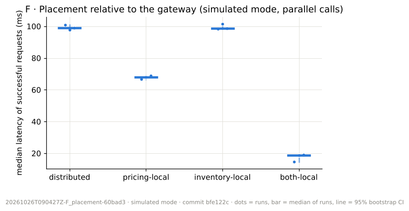
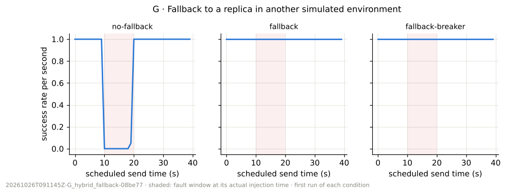
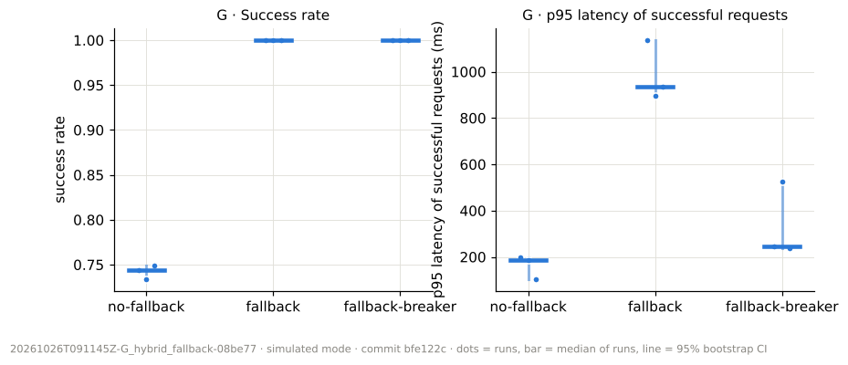

# Findings (Phase 8)

Every number below comes from the experiment records in `results/`. They were produced by one measurement campaign on Parv's Windows machine (`results/campaign_20261026T081408Z.json`), re-validated from disk and analysed by `scripts/analyze_results.py`; the numbers used are in `results/analysis/*.json`. Nothing here was typed in by hand from memory, and no run was excluded.

**Setting.**
- **Machine:** 13th Gen Intel Core i5-13500 (20 logical CPUs), Windows 10.0.26300, Docker Desktop 29.4.2 (20 CPUs, 7.6 GiB available to Docker), Compose 5.1.3, on mains power, Windows power plan "Balanced".
- **Code and run:** commit `bfe122c`, 2026-10-26 08:14–09:19 UTC, 64.8 min in total.
- **Container limits:** 0.5 CPU and 256 MiB per service; the load generator ran in its own container (1.0 CPU) on the Compose network.

**What "simulated" means here.** The aws/azure/gcp-*simulated* environments are labels on this one host. Link delays are configured, constant values injected by the gateway. So these findings are about **application-level behaviour on this machine**, not about any cloud provider.

**How to read the statistics.**
- **Unit of replication:** the run (3 runs per condition, 5 for A).
- **"Median"** means the median over runs of a per-run statistic.
- **Intervals:** "[a, b]" are 95% percentile-bootstrap intervals over runs (B = 2,000, seeded). With 3 runs these intervals are coarse and probably too narrow, so the per-run values are always given too.
- **Percentile thresholds:** p95 is reported only for runs with ≥ 200 samples and p99 only with ≥ 1,000. Only Experiment A reaches 1,000.

## Summary

| Hypothesis | Verdict on this machine | Key evidence |
|---|---|---|
| **H1** Delay on a sequential call adds ≈ *d*; in parallel with a slower call it adds less | **Supported** | Sequential shift − *d* = +1.6 / +1.3 / +2.9 ms for *d* = 25 / 50 / 100 ms, inside the baseline's 5.6 ms run-to-run range. Parallel shifts were 6.0 / 8.0 / 56.7 ms |
| **H2** Timeouts bound latency; breakers cut calls to the failing dependency and fail fast | **Supported, with a recovery cost** | Without a timeout, failures took 10.0 s (outer deadline); with an 800 ms timeout, ≤ 0.87 s. The breaker cut inventory calls by ≈ 78% and failed in ≈ 17 ms, but delayed recovery by about 5 s |
| **H3** Cross-environment fallback raises success at a latency cost | **Supported** | Success 0.744 → 1.000 (+0.257 [0.251, 0.266]); p95 of successful requests +749 ms [698, 1,032]. A breaker reduced that cost to 239–524 ms |
| **H4** Placement helps only when the moved service is on the critical path | **Supported** | Moving pricing (critical) saved 31.3 ms [29.0, 34.3]; moving inventory (not critical) saved 0.4 ms [−3.7, 2.6] |
| **H5** Retries raise success toward 1 − *p*^(1+*r*) and amplify load | **Supported** (independence holds by construction) | Success 0.504 / 0.768 / 0.877 vs predicted 0.5 / 0.75 / 0.875; inventory attempts per request 1.00 / 1.48 / 1.75 |
| **RQ5** (exploratory) Saturation of this host | **Observed** | The gateway reached its 0.5 CPU limit at 40 req/s. At 80 req/s successful throughput **collapsed** to 0.5–9.2 req/s (success 0.6–11.5%) instead of levelling off |

## A. Baseline (local mode, 20 req/s Poisson, 5 runs × 60 s)



- Every request succeeded in all 5 runs (n = 1,140–1,214 measured successes per run).
- Median latency (median of runs): **15.2 ms [14.4, 16.9]** (per run: 16.9, 15.2, 14.7, 16.9, 14.4).
- The tail varies much more than the median between runs:
  - p95 per run: 98.8, 54.1, 106.2, 49.7, 44.4 ms.
  - p99 per run: 302.6, 112.2, 229.0, 103.6, 89.2 ms; median of runs 112.2 ms.
  - These per-run tail values are not averaged; the ECDF shows them as separate curves.
- Generator send lag: p99 ≤ 3.2 ms in every run, so the load generator did not distort the schedule.
- Latency on this platform includes Docker Desktop's virtualised networking. Absolute values do not transfer between machines.

## B. Network delay propagation, H1 (simulated mode, 20 req/s, 3 runs × 30 s per condition)



The gateway→inventory link was fixed at 50 ms. The pricing link *d* was varied.

| *d* (ms) | Sequential median shift vs *d* = 0 | Shift − *d* | Parallel median shift vs *d* = 0 |
|---|---|---|---|
| 25 | 26.6 [22.7, 33.1] | +1.6 | 6.0 [−1.6, 8.4] |
| 50 | 51.3 [47.8, 57.7] | +1.3 | 8.0 [−2.5, 12.1] |
| 100 | 102.9 [100.7, 106.4] | +2.9 | 56.7 [48.6, 58.1] |

- **Sequential calls.** The shift tracks *d* within 1.3–2.9 ms. That is less than the run-to-run range of the *d* = 0 baseline (5.6 ms), and each interval contains *d*.
- **Parallel calls.** While *d* ≤ 50 ms, pricing runs alongside an inventory call that already takes 50 ms, and the shift stays small (6–8 ms, intervals including 0). At *d* = 100 ms pricing becomes the slower call. The shift (56.7 ms) is then close to *d* − 50 = 50 ms, as expected for a critical path of max(inventory, pricing).
- **Verdict: H1 supported.** The rejection criteria (sequential shift outside baseline variability, or parallel shift not smaller) were not met.
- **Measured overhead.** At *d* = 0, sequential calls took 76.2 ms against 50 ms of injected delay, so about 26 ms came from two service calls in series plus networking on this host.

## C. Primary dependency failure (local mode, fallback off, 3 runs × 40 s; fault from 10 to 20 s)



- Both fault types cost the requests sent during the fault window: success 0.754 for `error` and 0.754 for `hang`, against 0.75 if exactly the 10 s of 40 s were lost.
- **Errors fail fast; hangs cost the timeout.** The median failed request took 17 ms for `error` and 811 ms for `hang` (the 800 ms per-attempt timeout). For `hang`, p95 of all responses was 824–838 ms per run (pooled maximum 1,077 ms).
- Recovery after the fault: 1.0 s in every run, which is the 1 s measurement window's lag (see the methodology). Recovery was effectively immediate.

## D1. Resilience policies against an unresponsive dependency, H2 (local mode, 10 req/s, 3 runs × 40 s; hang from 5 to 25 s; fallback off)



| Policy | Success (median [CI]) | Failed-request latency (median, pooled) | p95, all responses (per run) | Inventory calls per run | Recovery after fault (s) |
|---|---|---|---|---|---|
| none (deadline 10 s) | 0.486 [0.464, 0.495] | 10,007 ms | 10,018–10,022 ms | 394–422 | 0.9–1.0 |
| timeout 800 ms | 0.502 [0.495, 0.514] | 811 ms | 817–818 ms | 372–412 | 1.0 |
| timeout + 2 retries | 0.527 [0.505, 0.554] | 2,509 ms | 2,551–2,653 ms | 759–829 | 0.1 |
| timeout + 2 retries + breaker | 0.391 [0.382, 0.415] | 17 ms | 49–72 ms | 162–195 | 4.5–5.4 |

- **(a) Without a timeout,** failing requests waited for the 10 s outer deadline.
- **(b) The per-attempt timeout bounded latency.**
  - With the timeout alone, the slowest of all responses was 870 ms, i.e. T = 800 ms plus ≤ 70 ms of processing and scheduling.
  - The stated criterion uses p99. Per-run p99 is not reportable here (about 400 responses per run), so the pooled maximum, a stricter test, is used instead.
  - With 2 retries, the bound T·(1 + r) + backoff ≈ 2,550 ms matches the observed p95 of 2,551–2,653 ms. The 3 s outer deadline capped the maximum at 2,765 ms.
- **(c) The breaker failed fast and cut calls to the failing dependency.**
  - Calls to the hung inventory instance fell ≈ 78% against timeout + retries (median 181 vs 816 per run; ranges 162–195 vs 759–829), with 216–236 calls rejected by the open breaker.
  - Failed requests returned in about 17 ms (pooled median 16.6 ms) instead of about 2.5 s.
- **Cost of the breaker.** It stayed open for its 5 s reset timeout after the dependency recovered. Recovery therefore took 4.5–5.4 s instead of ≈ 1 s, and success was *lower* (0.391 vs 0.527).
- **Retries finished slightly early.** With retries, success came back slightly *before* the fault ended (recovery 0.1 s). Requests sent in the last ~2.5 s of the fault succeeded on a retry after it expired.
- **Retries do not rescue a hang.** Success was ≈ 0.5 for none, timeout and retries alike, because the fault covered 20 of 40 s.
- **Verdict: H2 supported**, and the breaker's latency and load benefit comes with slower recovery.

## D2. Bounded retries under transient errors, H5 (local mode, 20 req/s, 3 runs × 30 s; 50% seeded errors on inventory-a)



| Retries *r* | Predicted success 1 − 0.5^(1+*r*) | Measured success (median [CI]; per run) | Inventory attempts per request (per run) | Median latency (ms) | p95 latency (ms, per run) |
|---|---|---|---|---|---|
| 0 | 0.500 | 0.504 [0.501, 0.516]; 0.516, 0.501, 0.504 | 1.00, 1.00, 1.00 | 16.6 | 45, 94, 103 |
| 1 | 0.750 | 0.768 [0.733, 0.805]; 0.805, 0.768, 0.733 | 1.43, 1.48, 1.52 | 22.3 | 75, 77, 99 |
| 2 | 0.875 | 0.877 [0.871, 0.879]; 0.871, 0.879, 0.877 | 1.75, 1.73, 1.76 | 27.7 | 131, 195, 171 |

- Each prediction lies inside the run-level interval.
- Attempts per request match the expected 1 + *p* + *p*² series (1, 1.5, 1.75), which is the load amplification.
- Latency rose with retries: median from 16.6 to 27.7 ms, p95 roughly doubling.
- **Verdict: H5 supported.**
- **Caveat.** The fault draws every attempt independently by construction (seeded per run). This therefore confirms that the retry logic, backoff and deadline behave as designed under load. It is not evidence about real-world failure correlation, which would weaken retries.

## E. Workload scaling, RQ5 (exploratory; local mode, 3 runs × 30 s per rate)



| Offered (req/s) | Successful throughput (per run) | Success (per run) | p50 (ms, per run) | Gateway CPU (median per run) |
|---|---|---|---|---|
| 5 | 4.4, 5.2, 4.8 | 1.00 ×3 | 20.8, 21.3, 23.0 | 7.8–11.4% |
| 10 | 9.6, 10.7, 9.8 | 1.00 ×3 | 16.8, 16.4, 17.0 | 11.2–14.2% |
| 20 | 20.2, 19.1, 20.5 | 1.00 ×3 | 23.1, 23.2, 24.7 | 25.7–28.8% |
| 40 | 40.6, 38.0, 36.2 | 0.99, 0.93, 0.94 | 43.1, 33.7, 47.2 | 46.4–47.1% |
| 80 | 9.2, 2.3, 0.5 | 0.11, 0.03, 0.01 | 1,357, 1,375, 1,129 | 49.7–49.9% |

- **Where it saturates.** The gateway container, limited to 0.5 CPU (50% in `docker stats`), was the bottleneck: 47% at 40 req/s, pinned at 50% at 80 req/s. Downstream CPU fell at 80 req/s because little work got through.
- **What happened at 80 req/s.**
  - Most failures were 503 `dependency_unavailable` responses (plus some degraded responses); p95 latency was reportable in only one run (1,741 ms).
  - 607–705 requests per run were dropped by the generator's in-flight cap (128).
  - Successful throughput **collapsed** far below the 40 req/s level instead of levelling off.
- **Why.** With open-loop arrivals and no admission control or load shedding in the gateway, the queue grows faster than it drains. Most of the work that is done is then spent on requests that will time out anyway.
- **Not a measurement artefact.** The generator's send lag stayed ≤ 6.2 ms (p95) at 80 req/s, and the runner used ≤ 30% CPU.
- **No carry-over.** Runs that followed an 80 req/s run (randomized order) were not degraded at their start.
- **Scope.** These numbers describe this host and these container limits only. CPU comes from host-side `docker stats` samples (about 1–3 s apart, host clock).

## F. Placement, H4 (simulated mode, parallel calls; links: inventory 50 ms, pricing 80 ms; 3 runs × 30 s)



| Placement | Median latency (ms, per run) | Improvement vs distributed |
|---|---|---|
| distributed | 101.0, 97.9, 99.1 | — |
| pricing-local (critical path moved) | 66.8, 67.9, 68.9 | **31.3 ms [29.0, 34.3]** |
| inventory-local (non-critical moved) | 98.5, 101.5, 98.7 | **0.4 ms [−3.7, 2.6]** |
| both-local | 14.7, 18.6, 19.1 | 80.5 ms [78.8, 86.4] |

- Moving the service on the critical path (pricing, 80 ms) saved about 30 ms. That is the difference between the two links, because inventory's 50 ms became the critical path.
- Moving the other dependency saved nothing measurable. Only moving both removed the injected delay.
- **Verdict: H4 supported.**
- **Caveat.** "Moving" relabels an instance's environment: the container stays where it is and only the injected delay changes.

## G. Fallback across simulated environments, H3 (simulated mode; primary hangs 10–20 s; 3 runs × 40 s)




| Condition | Success (per run) | p95 of successful requests (ms, per run) | Requests served by fallback (per run) |
|---|---|---|---|
| no fallback | 0.744, 0.734, 0.749 | 196, 187, 104 | 0 (failed requests: pooled median 813 ms, the timeout) |
| fallback | 1.000 ×3 | 1,136, 894, 936 | 190, 197, 212 |
| fallback + breaker | 1.000 ×3 | 244, 524, 239 | 245, 233, 250 |

- Fallback to the replica in the other simulated environment removed every failure: success +0.257 [0.251, 0.266].
- **The latency cost was the failure detection.** During the fault each fallback request first waited for the 800 ms timeout on the primary, then paid the longer 60 ms link to the secondary. That raised p95 of successful requests by 749 ms [698, 1,032]. Without fallback those slow requests were failures instead, so they did not count in that p95.
- **A breaker reduced this cost** to 239–524 ms (p95), because after a few failures it sent requests straight to the secondary.
- **Recovery and the reset timeout.** With the breaker, requests kept going to the secondary for ≈ 2 s *after* the primary recovered: 40–43 requests per run, until the 5 s reset timeout elapsed. Success never dropped, so the measured recovery time is 0. The reset timeout shows up as extra cross-environment traffic rather than as failures.
- **Verdict: H3 supported.** Both "failure domains" share one host and one kernel, so this tests the routing logic, not infrastructure independence.

## Threats to validity

| Threat | Effect on these findings | What we did |
|---|---|---|
| **One host for everything** (services, generator, all "environments") | Results describe this machine; no claim about AWS, Azure or GCP | Labels and notices everywhere; real-provider measurement is future work (`docs/cloud_setup.md`) |
| **Docker Desktop virtualisation on Windows** | Absolute latencies include the VM's networking and tails are heavy (A: p99 89–303 ms between runs) | Only within-campaign comparisons are made; per-run values are reported |
| **Few runs** (3 per condition; 5 for A) | Bootstrap intervals are coarse and probably optimistic | Per-run values shown everywhere; verdicts rely on effects much larger than run-to-run spread, except the parallel-call shifts at *d* ≤ 50 ms, whose intervals include 0 |
| **Tail percentiles** | p99 is unreportable outside A (n < 1,000 per run); A's p99 varies 89–303 ms | No tail claims beyond A; H2's p99 criterion was checked with the stricter pooled maximum |
| **Constant injected delay; application-level faults** | No jitter, loss or bandwidth effects; health checks stay green during faults | Injected delay exported separately; container-stop failures tested in Phase 7 (V16) but not part of this campaign |
| **Transient-error independence by construction** (D2) | H5 confirms implementation, not real-world behaviour | Stated with the verdict |
| **Recovery-time definition** (1 s rolling window, 3 s hold) | An immediate recovery reads as ≈ 1 s; very short effects can be smoothed | Parameters reported with every value |
| **Power plan "Balanced"; machine used normally before the run** | CPU frequency scaling may add variance | Recorded in the campaign file; randomized run order spreads drift across conditions |
| **Derived quantities** | Inventory calls are derived as total attempts − 1, valid because pricing was called once per order and never faulted | The analysis script refuses to derive them in any other configuration |
| **CPU from host-side `docker stats`** | Coarse (1–3 s samples, host clock) | Used only to locate the bottleneck in E, not as a performance result |

## What this campaign does not show

- Anything about real cloud providers, their networks or their prices.
- Whether multi-cloud placement is beneficial in practice. The placement effects here are fully determined by the configured delays; F shows that the critical path decides the benefit, not how large the benefit is in reality.
- Behaviour with more instances, autoscaling or a service mesh.

## Reproduce

```powershell
pwsh -File scripts/run_all_experiments.ps1                       # new campaign (about 65-70 min)
pip install -r requirements/analysis.lock                        # matplotlib (analysis only)
python scripts/analyze_results.py results/20261026T0*/ --out results/analysis
```
